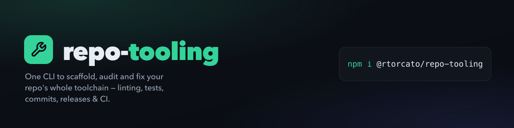

<!-- brand-kit:banner:start -->
<picture>
  <source media="(max-width: 640px)" srcset="./brand/banner-mobile.png">
  
</picture>
<!-- brand-kit:banner:end -->

<br>

[](https://github.com/rtorcato/repo-tooling/actions/workflows/ci.yml)
[](https://badge.fury.io/js/@rtorcato%2Frepo-tooling)
[](https://www.npmjs.com/package/@rtorcato/repo-tooling)
[](https://bundlephobia.com/package/@rtorcato/repo-tooling)
[](https://opensource.org/licenses/MIT)


One CLI to scaffold, audit and fix your repo's whole toolchain — linting, tests, commits, releases & CI.


Most tooling libraries give you one piece — just TypeScript configs, or just an ESLint preset. **repo-tooling** covers the entire lifecycle: TypeScript, Biome/ESLint, Vitest/Jest, Commitlint, Husky, Semantic Release, GitHub Actions CI, and supply-chain security (Dependabot + CodeQL) — all wired together. The interactive `setup` wizard scaffolds everything in one shot; `doctor` checks an existing project for drift; `fix` applies the missing pieces incrementally.

**[Full documentation →](https://docs.torcato.dev/repo-tooling/)**

> **Package manager: pnpm, by design.** Every generator scaffolds pnpm
> workflows, workspace files, and scripts. repo-tooling targets pnpm only for
> now — npm, yarn, and Bun aren't generated.

## Start a new project

```bash
npx @rtorcato/repo-tooling setup
```

The wizard asks about each piece and scaffolds the project. To skip the
questions, start from a preset:

```bash
npx @rtorcato/repo-tooling setup --preset library -d ./my-lib --yes
# presets: minimal | library | web-app | node-api | nextjs-app | react-app | swift-library

# The same, without the AI agent files (AGENTS.md, CLAUDE.md, .claude/, .cursor/, Copilot, .mcp.json.example)
npx @rtorcato/repo-tooling setup --preset library -d ./my-lib --yes --no-ai-setup
```

`minimal` is tsconfig + Biome + Vitest and nothing else. `swift-library`
scaffolds a SwiftPM package instead of an npm one. Without `--yes` in a terminal,
a preset first lists every file it would write and lets you uncheck parts.

## Already have a project?

Don't rerun `setup`. Use `doctor` and `fix`:

```bash
npx @rtorcato/repo-tooling doctor   # find what's missing or drifted
npx @rtorcato/repo-tooling fix      # apply fixes, asking before each one
```

Just want one config file? `npx @rtorcato/repo-tooling copy biome` (or
`tsconfig`, `oxlint`, `changesets`, …).

## Commands

| Command | What it does | Example |
| --- | --- | --- |
| `setup` | Interactive wizard that scaffolds a whole new project (add `--preset` to run non-interactively). | `npx @rtorcato/repo-tooling setup` |
| `list` | List every `fix` target, from the same registry as `fix --list` (`--json` for machine output). | `npx @rtorcato/repo-tooling list` |
| `copy <config>` | Copy a single config file into the current project. | `npx @rtorcato/repo-tooling copy biome` |
| `doctor` | Diagnose an existing project for missing or drifted tooling. | `npx @rtorcato/repo-tooling doctor` |
| `fix [target]` | Apply scaffolders for what `doctor` flagged (`--yes`, `--dry-run`, `--diff`). | `npx @rtorcato/repo-tooling fix` |

Every command takes `-d, --directory <path>`; run any with `--help` for its full flags.

`doctor` also ships as a GitHub Action, so CI can fail on drift:

```yaml
- uses: rtorcato/repo-tooling@v6.0.1  # pin the latest release tag
```

## Use with AI agents

| You use | Install |
| --- | --- |
| **Claude Code** | The plugin: `/plugin marketplace add rtorcato/repo-tooling`, then `/plugin install repo-tooling@repo-tooling` |
| **Any other agent** (Cursor, Copilot, Codex, …) | `npx @rtorcato/repo-tooling fix agents-md --yes` |

The [AI setup guide](https://docs.torcato.dev/repo-tooling/docs/guides/ai-setup/)
covers the other routes and what each file is for.

## Learn more

- [Getting started](https://docs.torcato.dev/repo-tooling/docs/guides/getting-started/): the full walkthrough
- [`.repo-tooling.json`](https://docs.torcato.dev/repo-tooling/docs/reference/repo-tooling-json/): the optional lockfile that lets `doctor` tell an opt-out from drift
- [GitHub Actions](https://docs.torcato.dev/repo-tooling/docs/reference/github-actions/#run-doctor-as-a-github-action): the `doctor` action's inputs and outputs
- [Biome](https://docs.torcato.dev/repo-tooling/docs/reference/biome/): extending the preset, and the Tailwind CSS v4 workaround
- [Using with repo-ai](https://docs.torcato.dev/repo-tooling/docs/guides/ai-issue-loop/): the optional companion that puts agents on your issue queue
- [Docs site](https://docs.torcato.dev/repo-tooling/docs/guides/docs-site/): the reusable deploy workflows (sites themselves come from [`@rtorcato/shared-docs`](https://github.com/rtorcato/shared-docs))

## What's new

See [CHANGELOG.md](CHANGELOG.md) for the full history.

## Related packages

- [@rtorcato/js-common](https://github.com/rtorcato/js-common) — General TypeScript/JS utilities (strings, dates, numbers, async, errors)
- [@rtorcato/browser-common](https://github.com/rtorcato/browser-common) — Browser Web API wrappers (clipboard, observers, storage, etc.)

## Roadmap

Direction and progress are tracked entirely on GitHub — see the
[milestones](https://github.com/rtorcato/repo-tooling/milestones) and
[open issues](https://github.com/rtorcato/repo-tooling/issues).

## Contributing

Contributions welcome — see [CONTRIBUTING.md](CONTRIBUTING.md).

## License

MIT — see [LICENSE](LICENSE).

<!-- js-tooling:skills:start -->
## Install the skills (`npx skills`)

Any agent that supports the [`skills`](https://www.npmjs.com/package/skills) CLI can install this repo's skills straight from GitHub — no clone, no package install:

```bash
npx skills add https://github.com/rtorcato/repo-tooling --skill 'npm-publish'
npx skills add https://github.com/rtorcato/repo-tooling --skill 'repo-tooling'
```
<!-- js-tooling:skills:end -->
